<h1 align="center">
  <picture>
    <source media="(prefers-color-scheme: dark)" srcset="website/static/readme/straza-logo-dark.svg">
    
  </picture>
</h1>

<p align="center">
  <strong>Open source runtime governance for AI agents.</strong><br>
  A service you operate, not a library inside the agent.
</p>

<p align="center">
  <a href="https://github.com/strazahq/straza/actions/workflows/ci.yml"></a>
  <a href="https://github.com/strazahq/straza/releases"></a>
  <a href="#license"></a>
</p>

<p align="center">
  <a href="https://straza.ai/">Website</a> ·
  <a href="https://docs.straza.ai/">Docs</a> ·
  <a href="#run-the-whole-stack-on-one-machine">Demo stack</a> ·
  <a href="#quickstart">Quickstart</a> ·
  <a href="https://docs.straza.ai/reference/policyset-grammar/">Policy reference</a> ·
  <a href="https://docs.straza.ai/guides/approve/phone/">Approver app</a> ·
  <a href="SECURITY.md">Security</a>
</p>

<p align="center">
  <strong>Straza is under heavy development.</strong> v2.2.0 is the latest release. Read the release
  notes before you upgrade, and the <a href="https://docs.straza.ai/project/roadmap/">roadmap</a>
  for what comes next.
</p>

**Your IGA decides who. Straza enforces what their agents may do, at every action.**

An agent runs with the shell, the files and the credentials of the person behind it, and a model
can be persuaded to use them. Straza is the control plane between your IGA, your identity
governance and administration system, and your agents. No AI runs inside Straza, and it never
proxies model traffic.

| Straza provides | How |
|---|---|
| Identity from your IGA | People, AI agents and role membership arrive over SCIM 2.0. Disabling a user there revokes every session of that user. |
| Role-based access per MCP server, tool and object | A role grants named tools on one MCP server. It can also cover only some of that server's objects, such as one database or one repository, named by an argument of the call. |
| A decision before each action | Each shell command, file write, network fetch and MCP tool call that reaches Straza is allowed, denied with a reason the model can read, or held for a person, against signed policy. |
| An MCP gateway that holds the credentials | A session sees only the tools its roles list, and the gateway adds each server's credential to an allowed call, so the agent never holds it. |
| Approval by a person | A held call waits in the console or on a phone, where a key in the phone's secure hardware signs the decision. |
| Delegated administration | Each MCP server has its own admin role, so its owners run that server and nothing else. A Straza role can also administer one area, such as audit or sessions, without the root role. |
| An audit record you can verify | Every decision joins a hash chain that `strazactl audit verify` recomputes on your machine, and sinks stream the records to a SIEM. |

Straza is for a company that runs AI agents against real systems and wants each agent's actions to
follow the roles it already governs. Its enterprise profile takes people, agents and role
membership from your IGA over SCIM 2.0, and a standalone profile runs on one machine with its own
sign-in, so you can try it without an IGA. Roles are made in Straza, and your IGA, or an admin on
standalone, assigns them.

The MCP gateway is a security boundary for a server the agent cannot call directly. A hook
installed for the user, on a machine the agent controls, is advisory.
[What each lane stops](https://docs.straza.ai/evaluate/what-each-lane-stops/) says how to test
each one.

<p align="center">
  <picture>
    <source media="(prefers-color-scheme: dark)" srcset="website/static/readme/held-call-dark.svg">
    
  </picture>
</p>

<p align="center"><em>Straza holds a call until the agent's sponsor, the person your IGA records as
accountable for the agent, approves it on a phone. The picture comes from a recorded run with the
Kubernetes MCP server, which the demo stack does not ship.</em></p>

## Run the whole stack on one machine

The demo stack, `deploy/compose/eval-stack`, runs Straza with midPoint as the
IGA, Keycloak and a working AI agent. It needs Docker with Compose 2.24 or later, 4 cores, 8 GB of
memory with swap and 20 GB of free disk. `up.sh` publishes every port on every interface with
public lab passwords, so run it on a trusted network only, or use the
[loopback shape](https://docs.straza.ai/guides/operate/demo-stack-defaults/).

```sh
git clone https://github.com/strazahq/straza.git && cd straza
deploy/compose/eval-stack/up.sh
docker compose -p straza-eval logs -f --no-log-prefix eval-seed
```

The [tutorial](https://docs.straza.ai/evaluate/try-it-on-the-demo-stack/) watches an agent be
allowed, denied and held, then stopped from midPoint.

## Quickstart

This path needs one machine and no Docker. Get `strazad` and `straza` from the
[releases page](https://github.com/strazahq/straza/releases), or build them with `make build`.

<details>
<summary><strong>Verify a release before you extract it</strong></summary>

`checksums.txt` on each release is signed by keyless cosign from the GitHub Actions job that
built it. Verify it before you extract:

```sh
cosign verify-blob --signature checksums.txt.sig --certificate checksums.txt.pem \
  --certificate-identity-regexp '^https://github\.com/Strazahq/straza/\.github/workflows/release\.yml@refs/tags/v[0-9]+\.[0-9]+\.[0-9]+$' \
  --certificate-oidc-issuer https://token.actions.githubusercontent.com checksums.txt
sha256sum -c checksums.txt --ignore-missing
```

The identity pattern pins the signing certificate to this repository, its release workflow and a
version tag, so a signature made anywhere else does not verify. It spells the organization
`Strazahq` as GitHub writes it into the certificate, and the match is case-sensitive.

</details>

Start the server in an empty directory. Its first boot prints the passwords of the `admin` and
`break-glass` accounts once.

```sh
strazad serve --profile standalone
```

In a second terminal, start the background service, which holds this machine's key. On Windows an
administrator [installs it](https://docs.straza.ai/guides/operate/install/#install-the-service-on-windows).

```sh
export STRAZA_HOME="$HOME/.straza"
straza service
```

In a third terminal, enroll this machine, sign in as `admin` in the browser, and run a destructive
command:

```sh
export STRAZA_HOME="$HOME/.straza"
straza enroll --server http://127.0.0.1:8420
straza exec -- rm -rf /tmp/x
```

```text
Straza starter policy: this sample rule denies commands that start with rm -rf. Delete files individually, or an admin can edit the standalone-starter PolicySet.
```

The command never runs. `straza install claude-code` puts the same decision in front of every
Claude Code tool call, and
[Try it on one laptop](https://docs.straza.ai/evaluate/try-it-on-one-laptop/) goes on to an approval.

<details>
<summary><strong>What each lane stops, and how to test it</strong></summary>

Read this before you test or review Straza. A lane is one place where Straza checks an
agent's actions, and only some lanes are a security boundary. If you report on Straza, say
which lane you tested.

Getting a denied call, an unlisted tool or a server's credential through the MCP gateway is a
real finding. So is editing or removing the hook of a managed install without root.

A way around a user-mode hook, `straza exec` outside the sandbox image or a command rule is
documented behavior and not a finding. So are an MCP server a person adds to their own harness
and what an interpreter computes inside its own process. This quickstart runs in user mode.

| Lane | What it stops | What it does not stop | How to test it |
|---|---|---|---|
| MCP gateway | A call that policy denies, a tool outside the session's roles, and any use of a server's credential by the agent. The decision, the tool list and the credential stay on the server. | Anything that does not go through MCP, and a server a person adds to their own harness. | Register a server, call a tool without its role and read the refusal. The credential never appears on the agent's side. |
| Managed hook | A harness tool call that policy denies, on a machine where the hook sits in root-owned files that strazad checks when a session starts. | An agent with root on that machine, and what an interpreter computes inside its own process. | Install with `sudo straza install --managed`, then try to edit the hook's files as the user. |
| User-mode hook | Mistakes. It tells a cooperating agent what policy says before it acts. | An agent that decides to skip it. This lane is advisory by design. By default the enterprise profile, the one for an organization, starts sessions only from a managed install. | Do not test it as a boundary. Use it to try policy on one laptop. |
| `straza exec` in the sandbox image | Every program the agent starts, except its own interpreter and the binaries on the image's allowlist. | Computation inside the interpreter. On an open machine it is as advisory as a user-mode hook. | Run the image and start a binary that is not on the allowlist. |
| Command rules and the classifier | The spellings a rule names, and commands with a clear sign of hidden intent, such as a download piped into a shell. | Every other spelling of the same act. A command rule is a convenience on top of the lanes above and never the boundary. | `strazactl policy simulate` with the command you want to check. |

The starter policy holds one sample rule that denies commands that start with `rm -rf`. It
shows what a deny looks like. It is not a delete guard, and another spelling of the same act
is not a bypass.

[SECURITY.md](SECURITY.md) says what is in scope and where to report a finding.

</details>

## How it works

<p align="center">
  <picture>
    <source media="(prefers-color-scheme: dark)" srcset="website/static/readme/architecture-dark.svg">
    
  </picture>
</p>

`straza` runs beside the agent and decides each action against the signed policy snapshot it
verified. MCP clients reach their servers through the gateway at `/mcp`. The server is one static
binary. It runs on SQLite on a laptop and on Postgres and NATS on
[Kubernetes](https://docs.straza.ai/guides/operate/run-it-on-kubernetes/), and the
[install guide](https://docs.straza.ai/guides/operate/install/) has the packages.

Straza works with [Claude Code](https://docs.straza.ai/guides/govern-an-agent/claude-code/),
[Codex CLI](https://docs.straza.ai/guides/govern-an-agent/codex-cli/),
[Gemini CLI](https://docs.straza.ai/guides/govern-an-agent/gemini-cli/),
[Python agents](https://docs.straza.ai/guides/govern-an-agent/python-agents/) and
[any MCP client](https://docs.straza.ai/guides/govern-an-agent/any-mcp-client/). Identity comes
from [midPoint](https://docs.straza.ai/guides/connect-identity/midpoint/) or
[any SCIM 2.0 system](https://docs.straza.ai/guides/connect-identity/generic-scim/), approvals
happen in the [approver app](https://docs.straza.ai/guides/approve/phone/) or the
[console](https://docs.straza.ai/guides/approve/console/), and audit records go to
[a SIEM](https://docs.straza.ai/guides/audit/sinks-and-siem/).

## Security model

Straza fails closed. When `straza` needs the server for a decision and cannot reach it, it denies
within 2 seconds. Straza does not govern what a model thinks or writes, does not protect an
endpoint from its own root and does not replace your IGA.

[docs/compliance.md](docs/compliance.md) maps its controls to ISO/IEC 27001 Annex A and NIS2
Article 21(2), and whether that meets a regulation is your assessment. The
[security model](https://docs.straza.ai/security/security-model/) lists the known limits, and
[SECURITY.md](SECURITY.md) says how to report a vulnerability.

## License

The core is AGPL-3.0-only. The specifications, the agent kits, the public Go packages, the
adapters and plugins, and the mobile approver app are Apache-2.0. Running an unmodified copy
inside your organization creates no obligation, and a commercial license is available through
[hello@straza.ai](mailto:hello@straza.ai).

<details>
<summary><strong>Which license covers which part</strong></summary>

| Part | License |
|---|---|
| `strazad`, `straza`, `strazactl`, the console, and everything else in this repository that the rows below do not name, including `cmd/`, `internal/`, `web/`, `deploy/`, `docs/`, `test/`, `tools/` and `website/` | [AGPL-3.0-only](LICENSE) |
| `spec/`, `kits/`, `pkg/`, `adapters/` and `plugins/`, the copy of the plugin skill and its catalog files that the docs site serves from `website/static/.well-known/`, `.claude-plugin/marketplace.json`, and the mobile approver app in its own repository | [Apache-2.0](LICENSE-APACHE) |
| Third-party source: the QR encoder `web/ui/src/vendor/qrcodegen.js` by Project Nayuki, and the 18 interface components in `web/ui/src/components/ui/` generated from shadcn/ui | MIT, with the notices in the files and in `web/ui/src/components/ui/LICENSE` |
| The prebuilt connector `deploy/compose/eval-stack/midpoint/connectors/universal-rest-connector.jar` for the evaluation stack, a separate program whose source is the [universal-rest-connector repository](https://github.com/Strazahq/universal-rest-connector) | Apache-2.0, its own license, with the license and notice files beside it |

Each part is licensed under the one license its row names, and no later version of the
AGPL applies. The licenses grant no right to use the Straza name or logo, and
[TRADEMARKS.md](TRADEMARKS.md) says how they may be used. [NOTICE](NOTICE) says where
the notices of the third-party software in the binaries, the image and the console
are.

</details>

Straza™ is a trademark of SynapTech s. r. o. Built in Slovakia.
