<h1 align="center">
  <picture>
    <source media="(prefers-color-scheme: dark)" srcset="website/static/readme/straza-logo-dark.svg">
    
  </picture>
</h1>

<p align="center">
  <strong>Open source runtime governance for AI agents.</strong><br>
  A service you operate, not a library inside the agent.
</p>

<p align="center">
  <a href="https://github.com/strazahq/straza/actions/workflows/ci.yml"></a>
  <a href="https://github.com/strazahq/straza/releases"></a>
  <a href="#license"></a>
</p>

<p align="center">
  <a href="https://docs.straza.ai/">Docs</a> ·
  <a href="#run-the-whole-stack-on-one-machine">Demo stack</a> ·
  <a href="#quickstart">Quickstart</a> ·
  <a href="https://docs.straza.ai/reference/policyset-grammar/">Policy reference</a> ·
  <a href="https://docs.straza.ai/guides/approve/phone/">Approver app</a> ·
  <a href="SECURITY.md">Security</a>
</p>

<p align="center">
  <strong>Straza is under heavy development.</strong> Expect frequent releases and changes between
  them, and read the release notes before you upgrade.
</p>

**Your IGA decides who. Straza enforces what their agents may do, at every action.**

Straza is the control plane between your IGA and your agents. People, AI agents and their
roles arrive from your identity governance and administration system over SCIM 2.0. Every shell
command, file write, network fetch and MCP tool call that reaches a Straza hook, the MCP gateway or
`straza exec` is decided against signed policy before it runs, on the agent's machine or at the
gateway. The action is allowed, denied with a reason the model can read, or it waits for a
person's approval, and the decision is recorded on a hash chain you can verify. No AI runs inside
Straza, and it never proxies model traffic.

| Start with | What you see | What it needs |
|---|---|---|
| [The whole stack on one machine](#run-the-whole-stack-on-one-machine) | AI agents born in midPoint, approvals in the console and on a phone, the kill switch | Docker with Compose 2.24 or later, 4 cores, 8 GB of memory with swap, 20 GB of free disk |
| [Sixty seconds on one machine](#quickstart) | A destructive command denied with its reason before it runs | `strazad` and `straza` |

<p align="center">
  <picture>
    <source media="(prefers-color-scheme: dark)" srcset="website/static/readme/held-call-dark.svg">
    
  </picture>
</p>

<p align="center"><em>Claude Code asks the Kubernetes MCP server to scale a deployment. Straza holds
the call until the agent's sponsor, the person your IGA records as accountable for
the agent, approves it on a phone. Drawn with the strings of a live run on the demo stack, with
this server attached for the recording.</em></p>

## What an agent sees

This example puts the
[Kubernetes MCP server](https://github.com/containers/kubernetes-mcp-server) v0.0.67 behind the
Straza gateway. The server holds no credential: strazad seals the cluster's token and adds it to
each call. The gateway names each tool after its server, so the agent calls
`kubernetes__pods_list`. One command gives the application role kubernetes-oncall two of the
server's 20 tools:

```sh
strazactl roles create kubernetes-oncall --app kubernetes --tools pods_list,resources_scale
```

| The agent calls | Decision | What the agent gets | Why |
|---|---|---|---|
| `kubernetes__pods_list` | Allowed | The pods. The gateway adds the token, and the agent never holds it. | The role's access lists the tool. |
| `kubernetes__resources_scale` | Needs approval | The new scale, once the agent's sponsor approves. No decision within 90 seconds is a deny. | A `mode: approve` rule. |
| `kubernetes__resources_delete` | Denied | `unknown tool "kubernetes__resources_delete"`, because the tool is not in its list at all. | The role's access leaves the tool out. |
| `rm -rf` in a shell | Denied | `Straza: destructive command denied by the agent guardrails` | The demo stack's guardrail policy, which matches every agent of its cast. |

The wait comes from one rule in the policy set `kubernetes-oncall-access`: `mode: approve` on
`resources_scale`, with `deciders: [sponsor]` and a limit of 90 seconds. A role's page in the
console reads such a rule back under Edit access and can change it there.
[Gate a tool in policy](https://docs.straza.ai/guides/serve-mcp-apps/catalogs-per-role/#gate-a-tool-in-policy)
walks both routes.

The demo stack does not ship this server. The answers above come from one recorded run with the
server attached to the stack, and the stack's own MCP step, below, runs on the midPoint MCP server.

## Run the whole stack on one machine

The demo stack is a whole deployment in Docker Compose: midPoint as the IGA,
Keycloak as the identity provider, strazad with its console and MCP gateway, the midPoint MCP
server behind that gateway, and sam, an AI agent that works on its own. Every AI agent is born in
midPoint and reaches Straza over SCIM, and the roles and approval rules come seeded. The first
boot builds strazad and the agent from source.

`up.sh` publishes every port on every interface with public lab passwords, so that a phone on your
network can pair with it. Run it on a trusted network only:

```sh
git clone https://github.com/strazahq/straza.git && cd straza
deploy/compose/eval-stack/up.sh
docker compose -p straza-eval logs -f --no-log-prefix eval-seed
```

On a cloud VM or any network you do not trust, start it this way instead. Every port binds to
loopback, you reach the stack through SSH tunnels, and a phone on your network cannot reach it:

```sh
cd deploy/compose/eval-stack
docker compose -f compose.yaml -f compose.loopback.yaml up -d --build
```

On Windows, run `deploy\compose\eval-stack\up.ps1` in place of `up.sh`, with host networking
turned on in Docker Desktop 4.34 or later, which sam needs. The seeder prints `EVAL STACK READY`
and the addresses to open:

```text
[seed] Landing page: http://localhost:8400  <- start here
[seed] Console:  http://localhost:8420/console/   (alice / alice)
```

The landing page lists every address, account and walkthrough. Four things to try first:

1. Read a deny. `docker compose -p straza-eval logs agent-sam` shows sam's start: it enrolls with
   its own key, opens a governed session, and its `rm -rf` is denied with a reason.
2. Decide an agent's request. `docker exec straza-sam sh /opt/sam/raise-ticket.sh` makes sam try a
   deploy, which comes back denied with a ticket for its sponsor alice or a security approver.
   Approve it as alice under Approvals in the console, or on a phone you pair there, and run the
   script again. The deploy runs once.
3. Pull the kill switch. Disable `sam-sre-agent` in midPoint, and Straza revokes its sessions
   within seconds. sam's next governed call, at most 10 minutes later, is refused, and
   `docker compose -p straza-eval ps agent-sam` shows it unhealthy.
4. Let an agent work in midPoint. On the self-service page, open Credentials as alice, sign in on
   the midpoint row and allow her agents. sam's reads then run in midPoint as alice, and its call
   to `midpoint__assign_role` waits for her approval.

The [demo stack guide](https://docs.straza.ai/get-started/enterprise-demo-stack/) covers the cast,
the tunnels, Elasticsearch and Kibana for the audit records, and
[the hardened shape](https://docs.straza.ai/get-started/enterprise-demo-stack/#demo-defaults-and-the-hardened-shape).

## Quickstart

Get `strazad`, `straza` and `strazactl` from the
[releases page](https://github.com/strazahq/straza/releases), or build all three with
`make build` from a checkout. [Deployment](#deployment) says how to verify a release first.

Start the server in the standalone profile in an empty directory. The first boot prints the
passwords of the `admin` and `break-glass` accounts once, so store both. It also seeds a starter
policy.

```sh
strazad serve --profile standalone
```

In a second terminal, enroll this machine. `straza enroll` prints an address and a code: open the
address, sign in as `admin`, and the terminal ends with `Enrolled as admin` and the device id.
Then run a destructive command through Straza:

```sh
straza enroll --server http://127.0.0.1:8420
straza exec -- rm -rf /tmp/x
```

```text
Straza starter policy: recursive force-delete is denied. Delete files individually, or an admin can edit the standalone-starter PolicySet.
```

The command never runs, and `straza exec` exits with status 2. `straza install claude-code` puts
the same decision in front of every tool call Claude Code makes.
[Your first governed session](https://docs.straza.ai/get-started/first-governed-session/) repeats
these steps as a person it creates, shows which rule decided with `strazactl policy simulate`, and
wires a live agent.

## How it works

<p align="center">
  <picture>
    <source media="(prefers-color-scheme: dark)" srcset="website/static/readme/architecture-dark.svg">
    
  </picture>
</p>

A harness hook, `straza exec` or the Python kit hands each action to `straza` on the agent's
machine. `straza` decides against the signed snapshot it verified, with no network call in the
common case. An MCP client reaches the MCP servers registered in Straza through the strazad
gateway at `/mcp`, which decides on the server and adds the upstream credential to an allowed call.
No database read sits on either path.

When a call needs approval, the request waits in the console, and Straza also sends it to the
approver's phone or to Slack when those are set up. The [Straza approver app](https://docs.straza.ai/guides/approve/phone/), in the
[App Store](https://apps.apple.com/app/straza-approver/id6798735074) and on
[Google Play](https://play.google.com/store/apps/details?id=ai.straza.approver), shows a redacted
preview of the call and by default binds the approval to its exact arguments. It signs the
decision with a key it generated in the phone's secure hardware, and strazad verifies every
signature.

Each audit record's hash covers the previous record's hash and the record's own CloudEvent.
`strazactl audit verify` recomputes the chain on your machine and names the first record that does
not match, and sinks stream the records to a SIEM by webhook or to a file. The security model says
[when a record can be lost](https://docs.straza.ai/security/security-model/#audit-records-can-be-lost).
Recording of prompts and replies is off unless a policy set turns it on.

## Integrations

| Area | Integration | Guide |
|---|---|---|
| Agent | Claude Code, Codex CLI, Gemini CLI, through their hooks | [Claude Code](https://docs.straza.ai/guides/govern-an-agent/claude-code/), [Codex CLI](https://docs.straza.ai/guides/govern-an-agent/codex-cli/), [Gemini CLI](https://docs.straza.ai/guides/govern-an-agent/gemini-cli/) |
| Agent | Python agents through the standard-library agent kit, with glue for LangChain, the OpenAI Agents SDK and the Claude Agent SDK | [Python agents](https://docs.straza.ai/guides/govern-an-agent/python-agents/) |
| Agent | A process with no hook surface, through `straza exec` and the sandbox image | [Hookless processes](https://docs.straza.ai/guides/govern-an-agent/hookless-processes/) |
| Agent | Headless CI and fleet agents, enrolled with an Ed25519 key | [Headless agents](https://docs.straza.ai/guides/govern-an-agent/headless-agents/) |
| MCP | Any MCP client, through the gateway at `/mcp` | [Any MCP client](https://docs.straza.ai/guides/govern-an-agent/any-mcp-client/) |
| Identity | midPoint over SCIM 2.0, the reference IGA, which runs in the demo stack | [midPoint](https://docs.straza.ai/guides/connect-identity/midpoint/) |
| Identity | Any other system that provisions over SCIM 2.0 | [Generic SCIM](https://docs.straza.ai/guides/connect-identity/generic-scim/) |
| Identity | Okta. The guide's SCIM requests were replayed, not yet run against an Okta tenant | [Okta](https://docs.straza.ai/guides/connect-identity/okta/) |
| Identity | An OIDC identity provider, Keycloak in the demo stack, or strazad's built-in sign-in | [Keycloak login](https://docs.straza.ai/guides/connect-identity/keycloak-login/) |
| Approval | Straza approver app for iOS and Android. F-Droid is planned | [Phone](https://docs.straza.ai/guides/approve/phone/) |
| Approval | Console, the self-service page and `strazactl` | [Console](https://docs.straza.ai/guides/approve/console/) |
| Approval | Slack, not yet run against a live Slack workspace | [Slack](https://docs.straza.ai/guides/approve/slack/) |
| SIEM | Webhook sink with an optional HMAC-SHA256 signature, and file sink | [Sinks and SIEM](https://docs.straza.ai/guides/audit/sinks-and-siem/) |

## Deployment

The server is one static binary. On a laptop it runs on its embedded SQLite database and event
broker, and the same binary runs on Postgres and NATS across a Kubernetes cluster. Release
archives for Linux, macOS and Windows on amd64 and arm64 are on the
[releases page](https://github.com/strazahq/straza/releases), each with an SBOM. The container
image `ghcr.io/strazahq/straza` is multi-arch and signed by digest, and
`helm install straza deploy/helm/straza` installs the chart in this repository, which bundles
Postgres and NATS by default and lets you bring your own.

`checksums.txt` on each release is signed by keyless cosign from the GitHub Actions job that
built it. Verify it before you extract:

```sh
cosign verify-blob --signature checksums.txt.sig --certificate checksums.txt.pem \
  --certificate-identity-regexp '^https://github\.com/Strazahq/straza/\.github/workflows/release\.yml@refs/tags/v[0-9]+\.[0-9]+\.[0-9]+$' \
  --certificate-oidc-issuer https://token.actions.githubusercontent.com checksums.txt
sha256sum -c checksums.txt --ignore-missing
```

The identity pattern pins the signing certificate to this repository, its release workflow and a
version tag, so a signature made anywhere else does not verify. It spells the organization
`Strazahq` as GitHub writes it into the certificate, and the match is case-sensitive. The
[install guide](https://docs.straza.ai/get-started/install/) and
[Run it on Kubernetes](https://docs.straza.ai/get-started/run-it-on-kubernetes/) cover the rest.

## Security model

Straza checks the actions that pass through its hooks, its MCP gateway and `straza exec`, and each
lane holds differently:

- A hook installed in user mode on an open machine is advisory, because an agent that can run
  anything can skip it. `sudo straza install --managed --server <server-url> claude-code` writes a
  root-owned layout the user cannot edit, and the server checks the measured wiring at check-in.
- The MCP gateway holds at a boundary, because the decision, the catalog and the credential all
  live on the server. It sees only what goes through MCP.
- Inside the sandbox image, `straza exec` is the only way the agent's process can run anything,
  except the agent's own interpreter and the binaries on the image's allowlist. On an open machine
  it is as advisory as a user-mode hook.

Straza fails closed. When `straza` needs the server for a decision and cannot reach it, it denies
within 2 seconds with a reason that says the security layer is unreachable. Disabling a user in
your IGA revokes every session of that user.

Straza does not govern what a model thinks or writes, does not protect an endpoint from its own
root and does not replace your IGA. [docs/compliance.md](docs/compliance.md) maps its
controls to ISO/IEC 27001 Annex A and NIS2 Article 21(2), and whether that meets a regulation is
your assessment. The [security model](https://docs.straza.ai/security/security-model/) lists the
invariants and the known limits, the
[trust model](https://docs.straza.ai/concepts/trust-model-and-non-goals/) says what each lane is
worth, and [Outbound connections](https://docs.straza.ai/reference/ports-and-network/#outbound-connections)
lists every destination strazad dials.

Report a vulnerability through
[GitHub private vulnerability reporting](https://github.com/strazahq/straza/security/advisories/new)
or to [security@straza.ai](mailto:security@straza.ai), never in a public issue.
[SECURITY.md](SECURITY.md) has the response times, the scope and the supported versions.

## Status

v1.1.0 is the first public release, and the project is under heavy development, so expect
frequent changes between releases. Microsoft Teams, a Cursor adapter and passkeys for the
built-in sign-in come next, and the [roadmap](https://docs.straza.ai/project/roadmap/) says what
follows. The [FAQ](https://docs.straza.ai/project/faq/) has more answers, each with a link to the
page that covers its topic.

## Contributing

Pull requests are welcome. Open an issue first for anything beyond a small fix, and accept the
[Contributor License Agreement](CLA.md) on your first pull request.
[CONTRIBUTING.md](CONTRIBUTING.md) has the steps and the gates every change passes, and
[SUPPORT.md](SUPPORT.md) says where to ask a question.

## License

The core is AGPL-3.0-only. The specifications, the agent kits, the public Go packages, the
adapters and plugins, and the mobile approver app are Apache-2.0, as the table below spells out.

| Part | License |
|---|---|
| `strazad`, `straza`, `strazactl`, the console, and everything else in this repository that the rows below do not name, including `cmd/`, `internal/`, `web/`, `deploy/`, `docs/`, `test/`, `tools/` and `website/` | [AGPL-3.0-only](LICENSE) |
| `spec/`, `kits/`, `pkg/`, `adapters/` and `plugins/`, the copy of the plugin skill and its catalog files that the docs site serves from `website/static/.well-known/`, `.claude-plugin/marketplace.json`, and the mobile approver app in its own repository | [Apache-2.0](LICENSE-APACHE) |
| Third-party source: the QR encoder `web/ui/src/vendor/qrcodegen.js` by Project Nayuki, and the 18 interface components in `web/ui/src/components/ui/` generated from shadcn/ui | MIT, with the notices in the files and in `web/ui/src/components/ui/LICENSE` |
| The prebuilt connector `deploy/compose/eval-stack/midpoint/connectors/universal-rest-connector.jar` for the evaluation stack, a separate program | Apache-2.0, its own license, with the license and notice files beside it |

Each part is licensed under the one license its row names, and no later version of the
AGPL applies. The licenses grant no right to use the Straza name or logo, and
[TRADEMARKS.md](TRADEMARKS.md) says how they may be used. [NOTICE](NOTICE) says where
the notices of the third-party software in the binaries, the image and the console
are. Running an unmodified copy inside your organization creates no obligation, and a
commercial license is available through [hello@straza.ai](mailto:hello@straza.ai).

Straza™ is a trademark of SynapTech s. r. o. Built in Slovakia.
