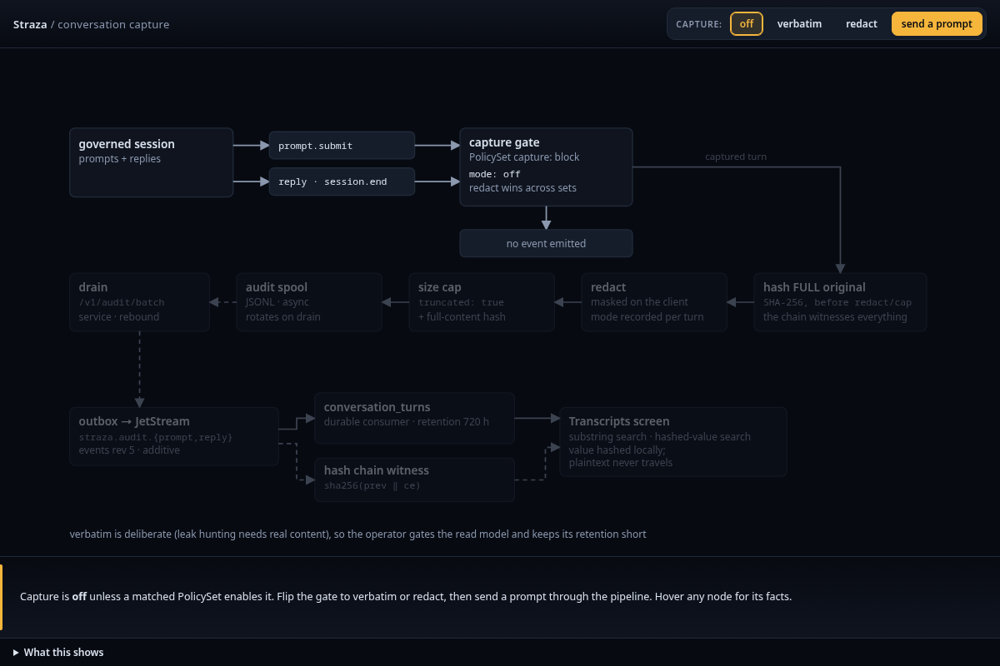

Every decision Straza makes about what an [agent]() may do leaves an audit record. Straza records allows as well as denies, because a missing decision would look the same as an allowed one. Each step a [person]() took on an [approval]() is recorded too. The records form a hash chain, so you can check later that none was edited or removed. A sink copies them to a system you control, such as your SIEM.

## What a record holds

An auditor can answer these questions about a decision from its record alone:

| The question | What the record holds |
|---|---|
| Who acted | The user, the session and the coding tool or MCP client it came from |
| What was asked | The tool and the command, or the MCP server, its tool and the arguments as sent. The record of every harness tool carries the tool's input as sent, cut at 8 KiB: the file text of a write, the prompt of a spawned agent, the arguments of a tool Straza does not classify. A classified tool also carries the harness's own name of it, such as `Skill` behind a file read |
| What was decided | The effect and the reason the agent read |
| By which rule | The rule's id and the name of the [policy]() set it belongs to |
| Under which policy | The id of the signed snapshot the decision was made under |

The snapshot id names the exact policy state that governed the decision, and it still does after the policy text changes. When no rule fired and a default decided, the rule and the set are left empty. On a server that declares [objects](), a gateway record also names the object, such as the space eng on the invented wiki server or the database sales_eu on postgres.

Besides tool decisions, the chain records every admin change with the person or token that made it and the credential it came through, so a leaked token shows as the token that acted. It also records sign-ins and refused sign-ins, session ends, the kill switch and its lift, each phase of an approval with its decider, and every [draft]() from its creation to its publish or discard. [Events and the audit record]() lists every type and field.

## How a record reaches the chain

The Straza service on the agent's [machine]() writes its decisions to a local spool and uploads them in batches. The Straza server, strazad, files each record under the signed-in user. A client may send only tool decisions and recorded conversation turns, so it can never write an admin or sign-in record into the chain. strazad's own decisions go to a queue in memory, then to a durable outbox in its database, then through its event bus into the chain.

Records are written after the decision, so in normal operation a tool call never waits for its record. A log that slowed every command would push operators to turn it off. Writing after the decision leaves a short window in which a record can be lost. If strazad crashes, the records still in memory are lost, and a full or unwritable spool on the machine loses records too. When strazad's queue is full, the enterprise profile makes new decisions wait for room and then refuses them, so nothing runs without its record. The standalone profile drops such records and counts the loss. [Known limits]() says how to watch for it. A record can also take a moment to appear after a step, because the service uploads in batches and strazad appends through a queue.

## The hash chain

Each record stores the hash of the record before it, and its own hash covers that link and its own bytes. Changing or removing a record breaks the chain at that point. A verify run walks the records in order and names the first record where the chain broke. [The console]() also checks the chain. Over TLS or on localhost, the Overview re-hashes the 25 newest records in your browser, and the Audit screen re-hashes every record it has loaded, starting with the newest 200.

The chain proves that no record was edited or removed in place. It does not by itself defeat someone who owns the database and rewrites every later record too, because a verify run inside that database recomputes the rewritten chain and finds it consistent. A copy outside the box defeats that attack, because a rewritten record no longer matches the copy your SIEM already holds.

## Delivery to your SIEM

Sinks forward records to another system. A webhook sink sends each record, or a batch of them, as an HTTP request that it signs when you give it a secret. A file sink appends records and syncs the file before it counts them as delivered. Delivery is at least once, so a receiver must drop duplicates by the record's id. An outage delays delivery. A delivery the receiver refuses is parked and can be replayed. Watch delivery failures, because a configured sink alone does not prove that every record arrived.

A sink with no filter receives every record except conversation text. Tool records are among them, and a tool record holds what the tool was given, which can be file text or the prompt an agent wrote for a subagent. Sending transcripts off the box needs an explicit setting in that sink's configuration. [Sinks and SIEM]() covers the setup.

## What an auditor can prove

With the chain and a copy in your SIEM, an auditor can show:

- that a given call was decided, by which rule, under which exact policy, and what the agent was told,
- who approved a held call, where they decided it, and which enrolled device signed a person's own decision,
- who published each change to servers, roles and policy, and which lines that widen access they confirmed,
- that no record was changed or removed since your SIEM received it.

An action that never reached Straza, such as a command on a machine without the hook, leaves no record, as [the security model]() sets out. A signed decision proves which device decided, but not that the person acted. [Compliance mapping]() shows which NIS2 measures and ISO/IEC 27001 controls these records supply evidence for.

## Conversations and the sentinel

Straza records the text of a conversation only when a policy set that matches the session turns recording on, and the session is told. The chain keeps only the hash and the size of each turn. The text goes to a separate store that deletes it after 30 days by default. [Record a conversation]() shows how to turn recording on. The input of a tool call is not conversation text. The call's record keeps up to 8 KiB of it whether or not recording is on.

After the fact, the audit sentinel reads the records and judges whole sessions, such as a burst of denies. Its verdicts are written to the same chain. It is off by default and never blocks or revokes anything. When it fails, it fails open and raises an alarm, as [The sentinel]() explains.



A record's own hash is the SHA-256 of the previous record's hash, a newline and the record's bytes. The bytes are stored as text and never re-rendered, because a reformatted record would no longer match its hash. Names the admin API adds for display, such as the username behind a user id, are kept outside the hashed bytes, so adding them can never invalidate a record.

Each record is at most 256 KiB. A longer one keeps a prefix of its longest strings, each followed by its whole length and SHA-256, so you can hash your own copy of a huge command and compare. When cutting cannot make it fit, the record keeps who acted, the decision and the command, and names the size and hash of the whole record. Gateway records keep the call's arguments up to 8 KiB, with a marker when cut.

After strazad accepts a batch from a machine's spool, the service removes the batch from the spool. Event ids let strazad drop a retried duplicate. An uploaded record that names no session takes the uploader's session, and one that names an earlier session of the same user on the same device keeps it. strazad files any other event type a client sends as a tool decision. An uploaded record that names a session of another user or another device, an unknown session, or a value that is not a session id is refused and stays out of the chain. strazad logs one warning line for each such session with the count of records, and `straza_audit_refused_total` counts each record. By then the client has already deleted the record. [Standalone and enterprise compared]() shows how each profile handles a full queue.

Once a record is committed to the outbox, a relay publishes it to the event bus, NATS JetStream, and a consumer appends it to the chain. The relay sends control events such as revocations ahead of audit traffic.

On enterprise, when strazad cannot queue a record because its database is down, the decision is refused with a reason that starts `Straza: this action did not run, because its audit record could not be written`.

Prompts and replies are hashed in full before any redaction or size cap, so the chain holds the hash of text it did not store. When two matched sets disagree on recording, the set that redacts applies. On enterprise the text can live in an object store you configure instead. A search for a leaked secret hashes the value on your side and matches the hash, so the secret itself is never sent.

A recorded conversation passes from the governed session through the policy gate, hashing, redaction and the spool to the chain.




