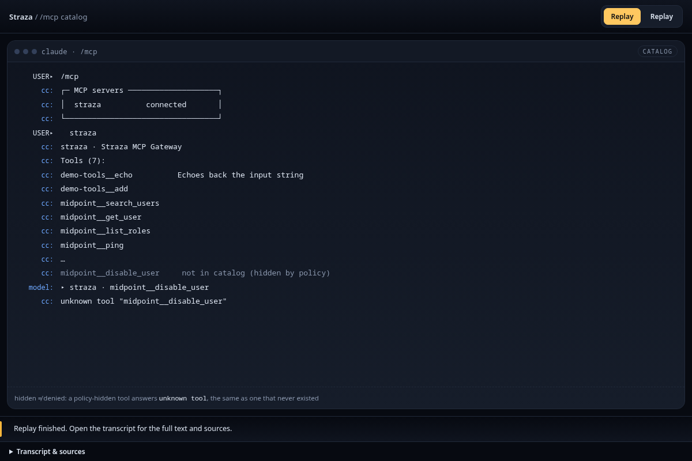
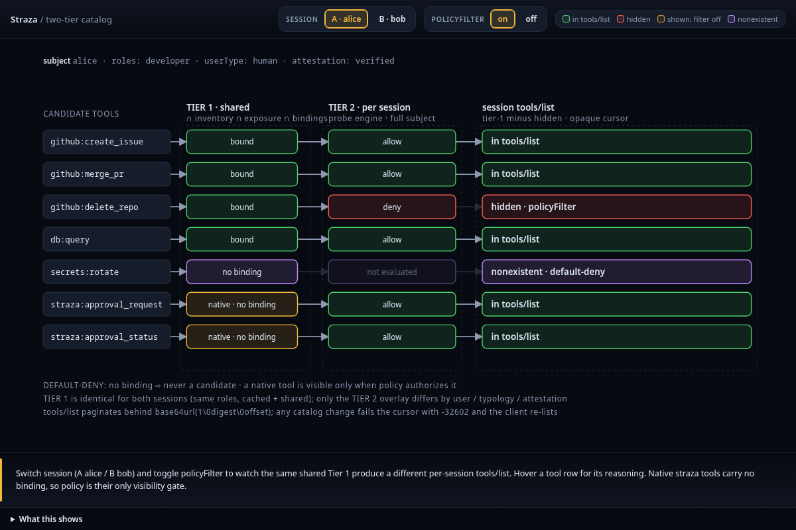

The MCP gateway gives an agent one connection to every MCP server you register in Straza. A session sees only the tools its roles reach, and by default the tools that policy denies are hidden from it. On each call the gateway decides with policy, asks a person when a rule says so, and adds the server's credential itself, so the agent never holds it. Every call leaves an audit record with its arguments.

The gateway governs the calls that go through it. An agent that has its own route or credential to an MCP server can skip the gateway, so remove those routes when you deploy.



## From MCP server to manifest

A manifest is one YAML document that declares an MCP server. It keeps the `server.json` document of the MCP Registry format and adds a Straza block for governance and runtime settings.

The server's name becomes both its policy identity and its tool namespace. Policy can select `apps: [github]`, for example, and a tool reaches the agent under a name such as `github__create_issue`.

The Straza block picks one of three runtimes, a child process that speaks MCP over standard input and output, a remote server over streamable HTTP, or a container image. It can also limit the tools the server exposes, set a request rate and an upstream timeout, and declare how Straza adds a credential. Unknown fields fail the install instead of being ignored. The enterprise profile refuses a command server and asks you to run it as its own service, as [Standalone and enterprise compared]() shows.

`strazactl apps import` turns an MCP Registry entry into a manifest. It prefers a remote over streamable HTTP, then a container image, an npm package or a Python package. Exactly one secret variable or header becomes the credential declaration. [MCP servers]() adds, imports and runs servers.

## The catalog each role sees

The gateway builds a session's tool list in two stages:

1. Straza intersects the tools the server lists now with the manifest's exposure list and the access rows of the session's roles. Only the tools in all three become candidates.
2. The gateway runs policy for the session. With policy filtering on, which is the default, a tool that policy denies is hidden. A tool that needs a person's approval stays visible and asks for a justification.

An access row already admits a tool, so a candidate that no rule gates runs. A tool without access and a tool hidden by policy return the same unknown-tool error, so the error never reveals whether a hidden tool exists.

A role assigned in the identity manager reaches a running session at its next check-in. The gateway then tells the client that the tool list changed, so the client lists again without a restart. Before any agent starts, `strazactl catalog preview` shows what a role or a user would see, with one status per tool and a sentence that says why: runs, gated by approval, denied by a rule, no access, not in the role's access row, or not running. [Access per role]() grants access and checks the preview.

## The objects a role covers

Some MCP servers reach many separate objects with one credential. A server that acts on the repositories of a GitHub organization through one GitHub App is an example: its credential reaches every repository the App was installed on. An access row names tools, so a role that may call a write tool on that server may call it on every one of those repositories. With a thousand repositories, one write role means write on all thousand.

Three steps close that gap. The server's tools carry marks that say which argument names the object and which tool lists the objects, and a person pins that declaration in the server's manifest, so Straza decides only from the pinned copy. Straza then calls the listing tool itself, every 10 minutes, and keeps the result as the server's object list. Each role's access row on the server says which objects it covers: `covers: every`, or `covers: {objects: [Strazahq/pay-api]}` with each object named. A named object is bound to its id in the list, so a renamed repository stays covered. A server's author reads the marks and the listing answer in [Object marks for server authors]().

The gateway checks every call to such a server against all the roles the session holds, before policy runs. The first role by name that binds the tool and covers the object grants the call, and the audit record and the credential lookup both name that role. When no held role covers the object, the call is refused. The agent reads which tool and object were refused, which objects its own roles cover for that tool, ten at most, and a hint to check the object's name or ask an admin for a role that covers it. An object the list does not hold gets the same sentence, so a refusal never tells an agent which objects exist.

The declaration gives each tool one of four reaches, and the reach decides which roles may call it:

| Reach | What the tool does | Which held role may call it |
|---|---|---|
| `argument` | Names one object in an argument, such as `repo` | A role that covers that object |
| `all` | Can reach every object at once, such as a search across repositories | A role on every object |
| `none` | Touches no object, such as a tool that answers who the caller is | Any role that binds the tool |
| `credential` | Does not name the object, and leaves the limit to the credential the call carries | A role on every object, because Straza does not check what a role's own login reaches yet |

A tool the pinned declaration does not name counts as `all` until a person decides, so a tool the server adds later never reaches a role on some objects. A draft refuses a role on some objects that binds an `all` or `credential` tool, and it says to make a role on every object for that tool. One server pins one object type. A tool with reach `argument` names its object in one argument, a required top-level string of its input schema. Drafts check that against the input schema only while the server runs and lists the tool. For a server that is not running, the draft gets a line saying nothing was compared, and that line does not block the publish. Whatever the draft saw, the gateway refuses a call that does not carry the argument as a string.

`every` means every object of the type, including the objects the server lists later. A holder of a role on every object can call a tool on a repository created a minute ago, before any listing has seen it. A role that names its objects cannot, until a person adds that repository to its covers line. When a person first pins a server's type, every existing access row on it gets `covers: every`, which is the reach the row already had, so the pin changes no role's coverage until someone narrows a role. From the pin on, the gateway does refuse a call whose object argument it cannot read, such as one with the argument missing, sent as another type than a string, or repeated under a second spelling, whatever role the caller holds. An approval or ticket given before the pin is asked for again, because from then on the approval key of a call that names an object carries the object. An access row on a pinned server without a covers line covers nothing. A server's admin may write `covers: every` on a role the server owns unless `admin.serverAdminsCoverEvery` is false, which leaves it to a global admin, as [the configuration reference]() lists.

Your IGA sees the same line. The role's SCIM group carries a read-only `covers` attribute that names the server, the type, and `every` or each named object, so a certifier sees that a role reaches two repositories and not all of them. The [midPoint guide]() shows it in the Covers column.

## Credentials stay on the gateway

A manifest picks one credential kind:

| Kind | How it works |
|---|---|
| `none` | The server needs no credential |
| `static` | An admin stores a server secret and may add overrides for particular roles |
| `token` | Starts with the caller's own pasted token. A configured agent can fall back to its sponsor's token or a shared one. |
| `oauth` | Starts with the caller's own browser grant. A configured agent can use its sponsor's grant, a shared one or a client-credentials path. |

Straza adds a static value as a header for a remote server, or as an environment variable for a child process. `oauth` and `token` belong to the caller and work only with remote servers. Straza resolves the current caller's own credential for each call, and a person who has none is denied. For an agent without its own, the manifest can deny the call or name a sponsor, shared or client-credentials path.

For every kind that needs a credential, a missing one denies the call instead of reaching the server without it. Straza's management APIs show metadata, never stored values, and server lists and exports mask the secret-shaped values in a manifest. The agent's Straza session token is never forwarded to the server. The server receives the credential and can return its own content, so it stays part of the trusted integration. [Credentials]() stores one.

## The gateway on the path

strazad serves the gateway at `/mcp`. To an agent it is one MCP server named Straza MCP Gateway, and every request carries a session token. For a tool call, the gateway checks these in order:

1. Whether the session may see the tool.
2. The server's rate limit for this session.
3. On a server that pins an object type, whether a role the session holds covers the object the call names.
4. Policy, against the live snapshot.
5. A person's approval, when the rule asks for one.
6. The server's credential.
7. An audit record with the arguments. The gateway queues it before the call and does not wait for it to be written.
8. The call itself, with a 30-second timeout by default.

A deny comes back as a tool error whose text starts with the Straza prefix and carries the reason, so the model reads the reason instead of taking it for a transport fault. The built-in MCP server named `straza` adds three approval tools on the same surface, and policy decides whether they are visible.

A harness that already runs hooks reaches the gateway through `straza mcp`, a stdio proxy that `straza install` registers as the one MCP server the harness knows. The harness then puts its own prefix in front of the server and tool names. Container runtimes start under a sandbox by default, with a read-only root, all capabilities dropped, no new privileges and no network. [Any MCP client]() connects a client without hooks.

## Why a gateway, and what it costs

The alternative hands each agent its own credentials and trusts the agent's machine to use them well. Straza rejects that, because a credential on the agent's machine is one the model can read, print and send, and no hook on an open machine can stop a process that already holds it. Keeping the secret on the gateway makes the gateway path hold at a boundary even when the agent's machine does not.

The price is a hop and a dependency. Every governed MCP call crosses the gateway, an unreachable gateway means no MCP tools at all, and the gateway is one more service to run at the scale of your fleet. It is designed to be stateless, so instances scale sideways and any instance serves any session.



The gateway verifies each request's session token against cached keys, then checks the denylist and the required attestation. If this strazad instance has not seen the session since its last restart, it asks the client to check in again.

Large catalogs come in pages behind a cursor that checks itself against the catalog it was issued for. An access row or policy change under a paging client fails the cursor, and the client lists again from the start.

For a static credential, Straza first looks for an override on the role whose access row admitted the call. If that role has none, it checks the overrides of the session's other roles in role-name order, and then uses the server secret. The server secret also feeds the health probe.

Static rows stay sealed in an in-memory broker and are decrypted when Straza resolves them, so the request path never reads the store. A command or container server that needs a static credential stays pending until one is configured. A remote server with a static credential needs it for its inventory and its health checks as well as for tool calls.

The detailed view below shows the two stages a candidate tool passes before it appears in a tools list.



Read next: [Trust model and limits]() states what each enforcement path is worth.
