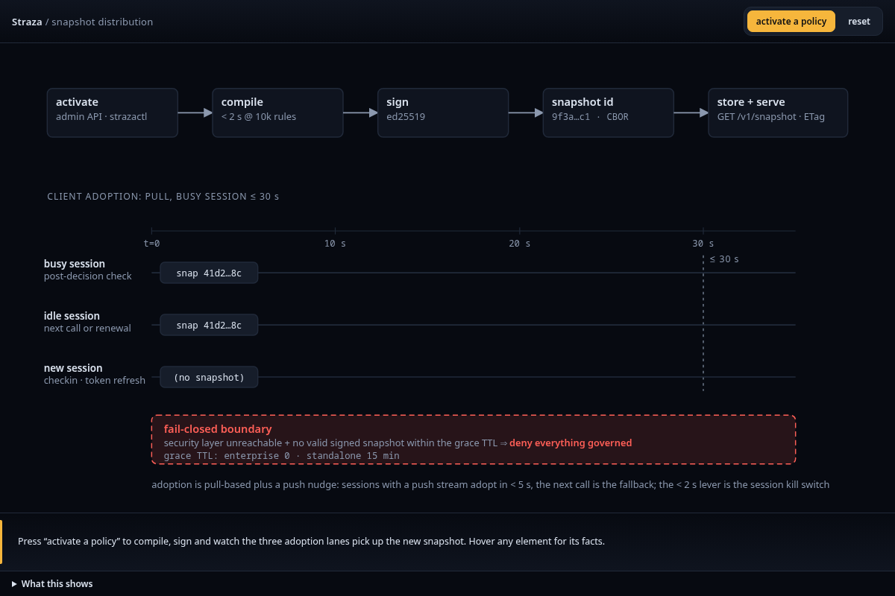

A policy decides whether a tool call may run, and on what terms. Your [roles]() say which [tools]() an [agent]() can reach. Policy says when a call to one of them runs at once, when it is refused with a reason, and when a [person]() must say yes first. The same rules decide a shell command on the agent's machine and a tool of an MCP server at the gateway.

## Rules and sets

A policy is a policy set: a named set of rules with a match that says whose sessions it governs, by role or by user. A set with an empty match governs every session. Each rule names the kind of call it looks at, such as a shell command or a tool on a named MCP server, and it can carry patterns such as command lines or file paths. It ends in allow or deny, with a reason the agent reads.

For each role, the console writes a set named after the role with `-access` at the end, so a role's rules are listed with its access. The table shows such a set for wiki, a server invented for this page, and for postgres, which runs adaptive-pg-mcp on the demo stack.

| | wiki, invented | postgres, adaptive-pg-mcp |
|---|---|---|
| The set | wiki-eng-access, for holders of the role wiki-eng | postgres-helpdesk-access, for holders of the role postgres-helpdesk |
| The gated tool | `page_edit` | `execute_sql`, free SQL that changes rows |
| Who decides | a holder of an approver role the rule names | the agent's sponsor, within 120 seconds |
| The role's other tools | run with no rule, because the role's access admits them | the same |

The [PolicySet grammar]() lists every key.

## How a rule matches a call

Every call reaches the engine as an event in Straza's own format, whichever coding tool or path it came from. A rule applies when the event's kind and tool are the ones it names. A rule that names MCP servers applies only to calls to those servers and not to local tools.

Some rules require something of the session, such as a minimum attestation level for its machine. A rule that applies checks that first, and a session that falls short is denied even when no pattern matches. Then the rule checks its deny patterns, and a match denies. Next it checks its allow patterns, and a match allows. If no pattern matches, the rule does not fire. A rule with no patterns fires with its own effect.

## How the deciding rule is picked

Straza evaluates every set that matches the session and collects the rules that fire. A deny from any of them wins. Priority only picks which rule the decision reports, with ties going to the set name and then the rule order, so it never lets an allow beat a deny. When a rule that asks a person fires on the winning allow, the decision names that rule, because the agent waits on its hold.

When no rule fires, the call takes a default:

| The call | The default |
|---|---|
| A tool of an MCP server that a role of the session reaches | Allow, because the role's access already admits it |
| A tool of an MCP server that no role of the session reaches | Deny |
| A local tool, such as a shell command | The profile's default: allow on standalone, deny on enterprise |

A new set therefore does not always narrow access. On enterprise, an allow rule lets through a local tool that the profile would deny.

A new standalone store starts with the live set `standalone-starter`, whose only rule denies six forms of a recursive forced delete. Once you delete it, Straza does not add it back. An enterprise server starts with no sets.

On a server that declares [objects](), the gateway checks the object a call names before any rule runs. A call on an object that no role of the caller covers is refused there, so no rule can allow it and no person is asked. To limit a tool to some objects, narrow the role, because a rule cannot name an object.

## The outcomes

A plain rule ends in allow or deny. A mode on a rule adds a step before a winning allow runs. No step runs before a deny, because a deny is final. Each step fails closed.

| Outcome | What happens |
|---|---|
| allow | The tool runs. |
| deny | The tool does not run, and the agent reads the rule's reason, or one that names the set and the rule. |
| approve | A person decides first: a holder of an approver role the rule names, or else the requester's sponsor. |
| confirm | Only the requester can say yes. A session whose agency mode is autonomous is denied at once. |
| serverCheck | The Straza server decides the call again with the live policy before it runs. An unreachable server is a deny. |
| classify | A built-in check reads a shell command for a hidden command, such as a download piped into a shell. A clear sign denies, and so does no answer within one second. |

[Approvals]() explains who decides a held call.

## Shell checks are never complete

A rule over a shell command matches the text of the command line the agent sends. The same action can be written another way, run from a script the agent wrote a moment earlier, or put together by a pipeline as it runs. A deny pattern misses each of these forms. The classify check catches common shapes of a hidden command, and it allows when it is not sure, so that ordinary work keeps running. The hook decides the command it is given and nothing that the command starts. A shell rule protects against an agent's mistakes. It is not a security boundary.

Put an action that must never run unchecked behind an MCP server instead, where the [gateway]() decides each call by the server and the tool. The gateway adds the server's credential itself, so the agent never holds it. A hook installed for the user is advisory, because an agent that can run anything can skip it. Straza enforces its security boundary at the gateway.

## How the policy reaches each machine



Every change to policy goes through a [draft](), which Straza checks against live state before it goes live. A publish compiles every live set into one snapshot, signs it with Ed25519 and names it by a hash of its bytes. The Straza service on each machine fetches the snapshot, checks the signature against keys it pinned when the machine enrolled, and uses it only after that check passes. It looks for a new snapshot when a session starts, when its token renews, at once when the server pushes a policy event, and after a decision once its last look is 30 seconds old. A decision on the machine then waits on the network only when a mode asks the server.

Each decision record names the snapshot it was made under, so the [audit]() trail shows the exact policy that applied. The snapshot is signed but not encrypted. On standalone anyone who can reach the server can read it, while enterprise serves it only to a checked-in session. Keep secrets out of policy.



A policy that governs agents has to be readable by the person who answers for the agent, and it has to decide thousands of calls an hour with no server in the loop. A general policy language can decide that many calls with no server, but it is hard to review, because nobody on a security review wants to read code to learn whether an agent may push to main. Straza chose rules a reviewer reads top to bottom, with an escape into the Rego language that can only add denies. These rules cannot express everything a general language can. When a set cannot express a condition, write a second set or add an approval.




Patterns are globs, or Go regular expressions behind a `re:` prefix, and both must match the whole value. A command pattern runs against the raw command string, against the arguments joined with single spaces, and against every single argument, so a deny still matches when the command uses different quoting or spacing. Paths are cleaned before matching. A call that touches several paths is denied when any path matches a deny, and allowed only when every path matches an allow.

A Rego module runs after the rules and may only add denies. The modules of one decision share a 100 ms deadline, which Straza checks between evaluation steps, and a decision past it is a deny. A module may not call a built-in that reaches the network, the file system or the process environment, or one whose single call can run far past the deadline. The [grammar page]() lists each refused built-in.

A set can also select by the identity's user type, agency mode or swarm ID. An identity without those attributes matches no such selector. A deny scoped that way therefore does not reach the identities that carry none, and an allow scoped to people never undoes a broader deny. If people need different access, scope the deny so it does not reach them, and simulate both kinds of identity before the set goes live.

The profile's default for local tools is a setting, which [Standalone and enterprise compared]() names, beside the [snapshot access]() of each profile.

Session start, prompt submission and the other events that are not tool calls are allowed. The Straza service writes no decision record for them, and a prompt reaches the chain only when a policy set turns recording on. An event of a kind Straza does not know is denied in both profiles, and the reason lists the kinds it knows. A tool outside Straza's list, or a call that names no tool, takes the local tool default, and where that default denies, the reason lists the tools Straza knows.

Straza checks the roles a set names when the set is checked and again when it goes live. The roles in `match` must be application roles, the kind that carries access, so naming one covers every way a person holds it. The roles an approve rule names must be approver roles or `straza-admin`, so holding an application role never gives the right to decide. A name that is not yet a role is still accepted in `match`, and it matches nobody until the role exists.

The fact that a role's access admits an MCP tool comes from the gateway and not from the client's request. Straza's built-in approval tools never carry it, so policy alone gates them. The two drafting tools carry it, because the gateway lists them only to holders of the Straza role `straza-draft-config`.

Checking a set runs the same parser the snapshot compiler uses, so a set written in the console and a set kept in git are refused for the same errors at the same step. Simulation takes a call and a user or a list of roles, and evaluates the call against the live snapshot. It can lay a set from a local file over the stored set of the same name, so you see what publishing would change. The answer names the effect, the deciding rule with its reason, and the snapshot. On a server that declares objects it runs the object check first, as the gateway does. [Simulate a call]() walks through it.

A publish sorts every live set by name, compiles them into one CBOR document, signs it with the server's Ed25519 key and checks the result itself. The snapshot's id is the SHA-256 of the signed bytes, which carry the time of the publish and the signing key's id, so the id names exactly one signed snapshot.




